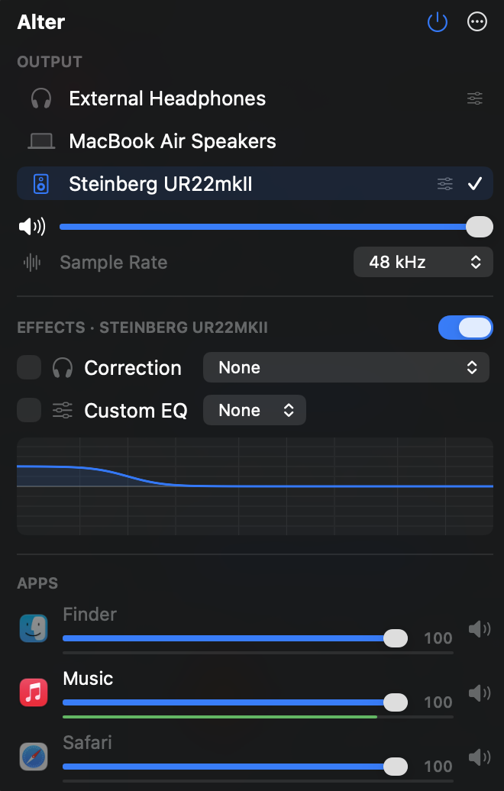

# Alter

A lightweight macOS menu bar app for:

- App specific volume controls and mute,
- switching the output device,
- a separate effect chain for each output device.



## Features

- **Per-app volume and mute.** Apps are grouped under the app responsible for them, so Safari's and Chrome's helper processes count as one app. Levels are remembered across launches.
- **Output switching** from the menu, with hardware volume. Devices without hardware volume (HDMI, for example) get software volume.
- **Effects for each device**, in this order:
    1. Preamp (automatic headroom, or manual)
    2. Correction EQ
    3. Custom EQ
    4. Bass/treble tone
    5. Loudness compensation that follows the volume
    6. bs2b-style crossfeed
    7. Balance
    8. Gain trim (level matching)
    9. Lookahead limiter
- **Headphone presets:**
    - Search the AutoEQ database in the app.
    - Import EqualizerAPO/AutoEQ `ParametricEQ.txt` (PK, LS/LSC, HS/HSC, LP, HP, NO; Q or `BW Oct`; shelf slopes).
    - Import `GraphicEQ.txt`. The curve is fitted to 4–20 biquads, and the fit error is shown.
    - Paste presets from the clipboard.
    - Export as `ParametricEQ.txt`.
- **EQ editor** with draggable handles on the response graph, plus a band table.

## How it works

Alter uses Core Audio **process taps**, available on macOS 14.2 and later. Alter targets macOS 15. No virtual audio driver is installed.

For each app that needs processing, Alter creates:

- a private tap that mutes the app's own output,
- a private aggregate device whose main sub-device is the current output.

The aggregate's IOProc applies the app's volume and the active device's effect chain, then plays the result.

Some properties of this design:

- **Low overhead.** Alter only intercepts an app when it changes something: a volume other than 100%, mute, or effects on the current device. Everything else goes straight to the hardware. Idle sessions stop after 4 seconds.
- **Low latency.** An intercepted app plays about 9 ms later than it would directly (11 ms with the limiter's 1.5 ms lookahead). Most of that is two IO buffers of ~2.7 ms each (128 frames at 48 kHz). Devices whose minimum buffer is larger use that minimum instead.
- **Safe on crash.** If Alter quits or crashes, the system destroys its taps and every app plays directly again.
- **Real-time safe.** The audio thread does not allocate or lock. Effect parameters are published as immutable `ChainState` objects through an atomic pointer.

The first time Alter needs to intercept audio, macOS asks for **System Audio Recording** permission.

## Build

Requires Xcode 16 or later and [XcodeGen](https://github.com/yonaskolb/XcodeGen).

```bash
xcodegen generate
xcodebuild -scheme Alter -configuration Release -derivedDataPath build/DerivedData -allowProvisioningUpdates build
open build/DerivedData/Build/Products/Release/Alter.app
```

Run the tests with:

```bash
xcodebuild -scheme Alter -derivedDataPath build/DerivedData test
```

The live AutoEQ network test runs only when you set `TEST_RUNNER_ALTER_NETWORK_TESTS=1`.

Builds are signed automatically with the Apple Development identity of team `W3JP6JQN3M`, set in `project.yml`. Pass `-allowProvisioningUpdates` to `xcodebuild` so Xcode can manage the certificate. A stable signature means macOS keeps the System Audio Recording permission across rebuilds.

Launch Alter with `open`, not by running the binary directly. If its parent process is a terminal, TCC charges the permission request to that terminal.

### Debug aids (Debug builds)

- `ALTER_DEBUG_METERS=1` logs the output level of each intercepted app once a second.
- `ALTER_SNAPSHOT_DIR=/path` renders the menu and the effects window to PNG files.

## Data

Everything is stored in `~/Library/Application Support/Alter/`:

| File              | Contents                                      |
| ----------------- | --------------------------------------------- |
| `devices.json`    | Profiles for each device, keyed by device UID |
| `presets.json`    | EQ presets                                    |
| `settings.json`   | App volumes and options                       |
| `AutoEQ-INDEX.md` | Cached AutoEQ index                           |

## Layout

| Folder              | Contents                                                                        |
| ------------------- | ------------------------------------------------------------------------------- |
| `Alter/CoreAudio`   | Devices, process monitor, tap sessions, output engine, permission check         |
| `Alter/DSP`         | Biquads, chain builder, real-time stream processor, effect settings             |
| `Alter/Presets`     | Preset model, EqualizerAPO parser and exporter, GraphicEQ fitter, AutoEQ client |
| `Alter/Persistence` | JSON storage                                                                    |
| `Alter/UI`          | Menu popover, effects window, EQ graph, band editor, AutoEQ search, settings    |
